# History Widgets

History strip widgets for [Signal K](https://signalk.org/) chartplotters that
support Plotter Extensions, such as Freeboard-SK. A strip shows one value over
the last minutes or hours, newest at the top, like the wind history page of a
sailing instrument: the live value, the window's minimum, average and maximum,
and one bar per moment between them. The scale follows the window's own
minimum and maximum, so the trace fills the strip however little the value
moves.

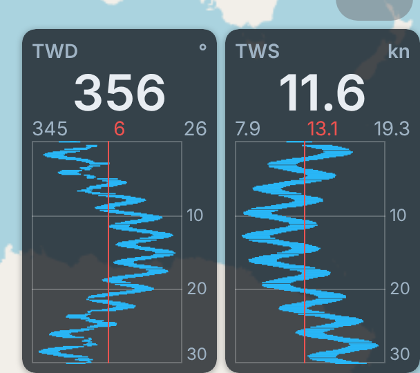

The package brings these widgets, each in the size it is placed at (columns x
rows of the widget area):

| Widget                                                       | Size           | Shows                                                             |
| ------------------------------------------------------------ | -------------- | ----------------------------------------------------------------- |
| [History strip](#use)                                        | 1x2, wide 2x2  | one value over 5 minutes to 24 hours                              |
| [Wind steering](#wind-steering)                              | 2x2            | apparent and true wind, close-hauled lines, wind shift            |
| [Tank level, Battery charge](#tank-level-and-battery-charge) | 1x2, small 1x1 | a tank's level or a bank's state of charge, coloured by its zones |
| [Clock](#clock)                                              | 2x1            | local, UTC or boat time, corrected to GPS                         |
| [Depth profile](#depth-profile)                              | 2x1, large 2x2 | the depth over time like an echo sounder                          |
| [System health](#system-health)                              | 1x1            | CPU temperature, load and memory of the computer Signal K runs on |
| [Polar performance](#polar-performance)                      | 1x1            | how close the boat sails to its polar, in percent                 |

## Use

1. Install **History Widgets** from the App Store and restart the server. The
   plugin is enabled on install.
2. In Freeboard-SK, press and hold an empty spot in a widget area (a corner or
   the bottom centre) and pick a widget, for example **History strip** (tall)
   or **History strip (wide)**.
3. For a strip, pick the value: a quick button (TWD, TWS, TWA, AWA, AWS, SOG,
   STW, COG, HDG, depth, air pressure, air and water temperature, polar and
   VMG percentage) or any numeric Signal K path. Tap the time span, from 5 minutes to 24 hours.

For several values, place several strips next to each other. Press and hold a
placed widget to change it or remove it.

Every widget draws on a dark card unless you pick another **Background** in
its settings: **Light** for a bright screen in daylight, or **Auto** to follow
the screen's light or dark setting. In Freeboard-SK's night mode every widget
turns red on black, whatever its background.

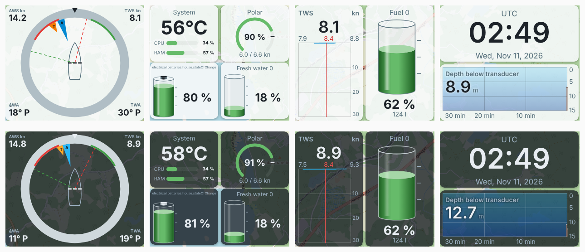

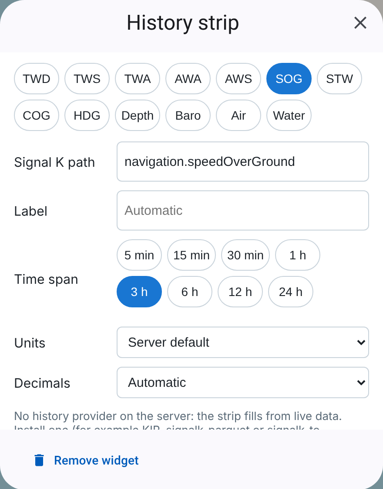

## History

With a History API provider on the server (for example signalk-questdb, which
the App Store suggests alongside this plugin, the KIP plugin, signalk-parquet
or signalk-to-influxdb2) a new strip shows as much of the window as the
provider has recorded for that path; a provider that was installed recently
fills only the time since then. Without one the strip starts empty and fills
from live data. The configuration panel says which case applies.

After a server restart the history provider can take a while to come up. A
strip or depth profile that loads meanwhile shows live data and keeps asking
for its history for up to ten minutes; once the provider answers, the earlier
part of the window fills in without losing what was collected in between. A
screen that was asleep fills the gap from history when it wakes up.

Directions such as true wind direction or heading read 0 to 360 and stay one
band when they swing across north. Other angles, such as the apparent wind
angle, are signed. Values show in the unit set for the path in the server's
Unit Preferences, unless the strip sets its own.

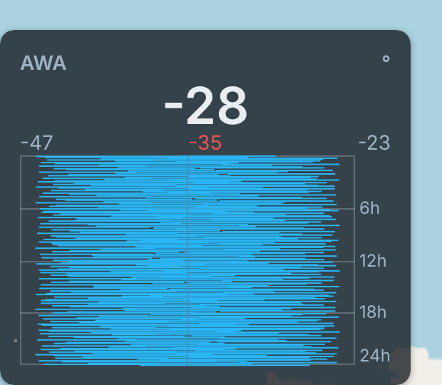

## Wind steering

A square dial for steering by the wind, bow always up. In its default
compass mode the card turns with the heading; set to wind angles it shows 0
to 180 degrees port and starboard instead. On the dial:

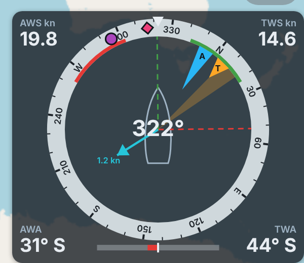

- the apparent wind (blue pointer, **A**) and the true wind (orange marker,
  **T**), with AWS, TWS, AWA and TWA in the corners;
- dashed close-hauled lines for both tacks: red is the heading on port tack,
  green on starboard tack, at the close-hauled angle off the true wind
  (45 degrees unless set otherwise);
- the wind shift fan: how far the true wind direction swung over the last
  minute (or the window you choose), so a lift or a header shows at a glance;
- the next waypoint (purple dot) when a destination is active, course over
  ground (pink diamond) when the boat is moving, the current as an arrow
  with its drift, and the rudder angle as a bar under the dial.

Press and hold the dial to choose the dial type, true or magnetic north,
true wind through the water or over the ground, the close-hauled angle, the
shift window, and which marks to show. Values older than ten seconds are
hidden rather than shown stale. It reads standard Signal K paths:
`navigation.headingTrue`, `navigation.courseOverGroundTrue`,
`navigation.course.calcValues.bearingTrue` and `environment.current.setTrue`
(with magnetic north `navigation.headingMagnetic`,
`navigation.courseOverGroundMagnetic`,
`navigation.course.calcValues.bearingMagnetic` and
`environment.current.setMagnetic`), plus `environment.wind.*`,
`navigation.speedOverGround`, `environment.current.drift` and
`steering.rudderAngle`.

## Tank level and battery charge

A tank's level or a battery bank's state of charge as a glass cylinder or, if
you prefer, a flat bar, with the percentage underneath. A tank that publishes
its capacity also shows the volume left, and a battery bank its voltage and
current, in the units set in the server's Unit Preferences. A green arrow up
means the bank is charging, a red arrow down that it is discharging. The colour follows the zones
set for the level in the server's metadata (`meta.zones`): green when the
level is normal, yellow in an alert or warn zone, red in an alarm or
emergency zone. Marks beside the bar show where the zones begin, so you see
how far the level is from the next one. Without zones the bar stays green.

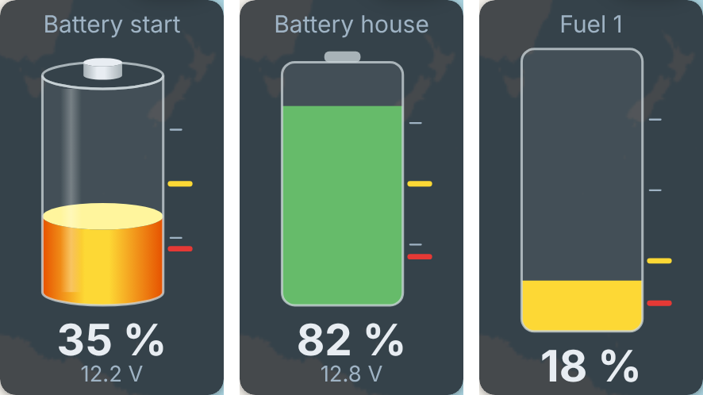

Both come in a small size too (1x1), with the reading beside the bar:

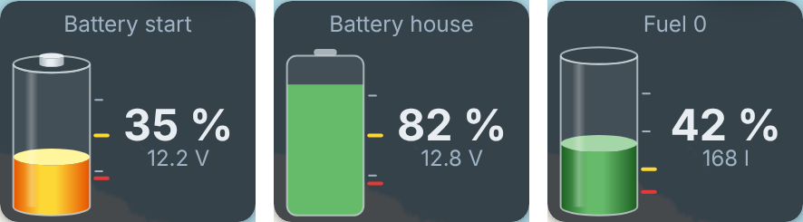

Press and hold the widget to pick another tank or bank. The panel lists every
`tanks.*.*.currentLevel` (or every
`electrical.batteries.*.capacity.stateOfCharge`) on the server with its
current level, plus any other 0 to 100 % value, and offers the look (3D or
flat) and whether to show the volume or voltage and current as buttons, so it is set up
with a few taps and no keyboard. A level older than two minutes shows as
`--`.

## Clock

The time, as large as the widget allows, with the date underneath. It shows
this screen's time zone, UTC, or the boat's time zone as the server reports
it (`environment.time.timezoneRegion`, or `environment.time.timezoneOffset`).
While the server reports no usable boat zone, a clock set to boat time shows
this screen's own zone instead and says so above the time.
A screen whose clock is more than two seconds off the GPS time
(`navigation.datetime`) follows the GPS, which keeps a display that booted
without a network right.

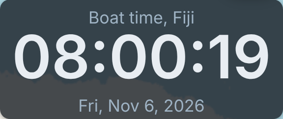

Press and hold the clock to choose the zone, 24 or 12 hours, and whether to
show seconds and the date, all with buttons.

## Depth profile

The depth over the last minutes or hours like an echo sounder: time runs
left to right with now at the right edge, depth runs down from the selected
reference, and the seabed is filled in below each moment's shallowest reading
(for history, the provider's minimum; a provider that gives only averages
shows the average, so the seabed can look deeper than the shallowest depth
recorded). The current depth sits top left in the unit set in the server's Unit
Preferences. Like the strip, it is seeded from the History API: with a
history provider on the server it is full as soon as it opens, without one
it fills from live data as the window passes.

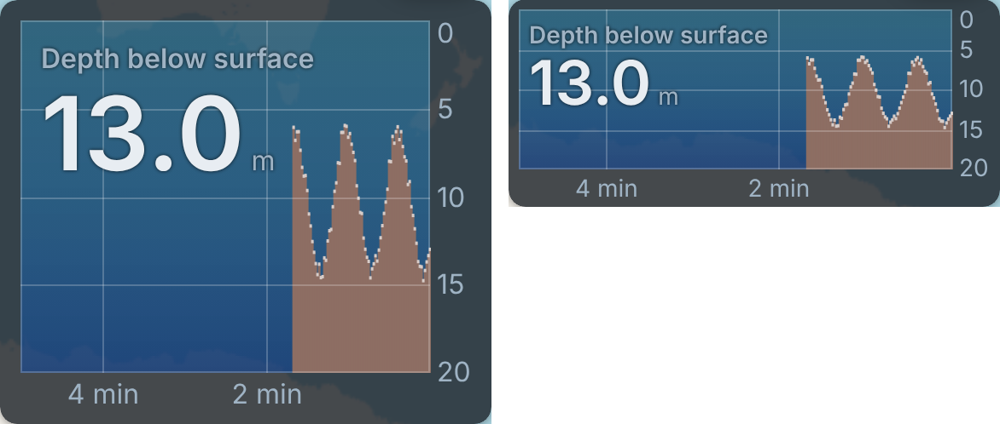

It follows the depth below the surface when the server has it, else below
the transducer or the keel. Press and hold it to pick one of those yourself
or another window, from 5 minutes to 24 hours, all with buttons.

## System health

A small tile (1x1) for the computer Signal K runs on: the CPU temperature in
large type, and bars for CPU load and memory in use, with storage as an
option. It reads what signalk-rpi-stats publishes under `environment.rpi`,
which the Universal Installer sets up with RPI Manager. A reading turns
yellow from 70 °C, 80 % CPU or memory and 85 % storage, and red from 80 °C
(where a Raspberry Pi starts slowing down), 95 % CPU, 90 % memory and 95 %
storage; zones set in the path's metadata take their place. When the Pi
reports low voltage or throttling, that replaces the title in red. A reading
older than two minutes shows `--`.

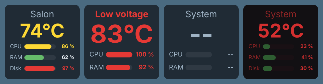

Press and hold the tile to show or hide storage and to give it a label.

## Polar performance

A small tile (1x1) that shows how close the boat sails to its polar: the
boat speed as a percentage of the polar speed, averaged over 10 seconds, in
a gauge from 0 to 120 % with a mark at 100 %. Underneath it shows the boat
speed against the polar speed. The value comes from
[Polar Performance](https://github.com/htool/signalk-polar-performance-plugin)
(`performance.polarSpeedRatio`), which compares the boat with the polar
chosen in [Polar Management](https://github.com/Asw1n/signalk-polar-management);
install both, and in the Polar Performance webapp switch on "Polar speed &
ratio" on the Outputs tab ("VMG & polar VMG" for the VMG source); both are
off by default. The tile turns yellow below 80 %; zones set in the path's
metadata take its place. When the polar has no target, in irons, in near
calm or without a polar, the tile shows `--` and "No target".

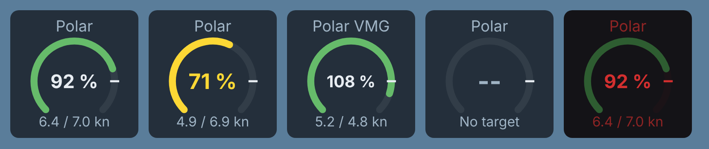

Press and hold the tile to compare VMG instead of boat speed, to average over
5, 10 or 30 seconds, to hide the speeds and to give it a label.

To see how the boat sailed against the polar over time, pick **Polar %** or
**VMG %** on a history strip. A dashed line marks 100 % and always stays in
view, so the strip shows at a glance whether the boat sailed above or below
its polar. Times without a target leave a gap.

## Requirements

- Signal K server 2.22.1 or newer (History API v2) on Node 24 or newer
- A chartplotter that hosts Plotter Extensions widgets, such as Freeboard-SK
